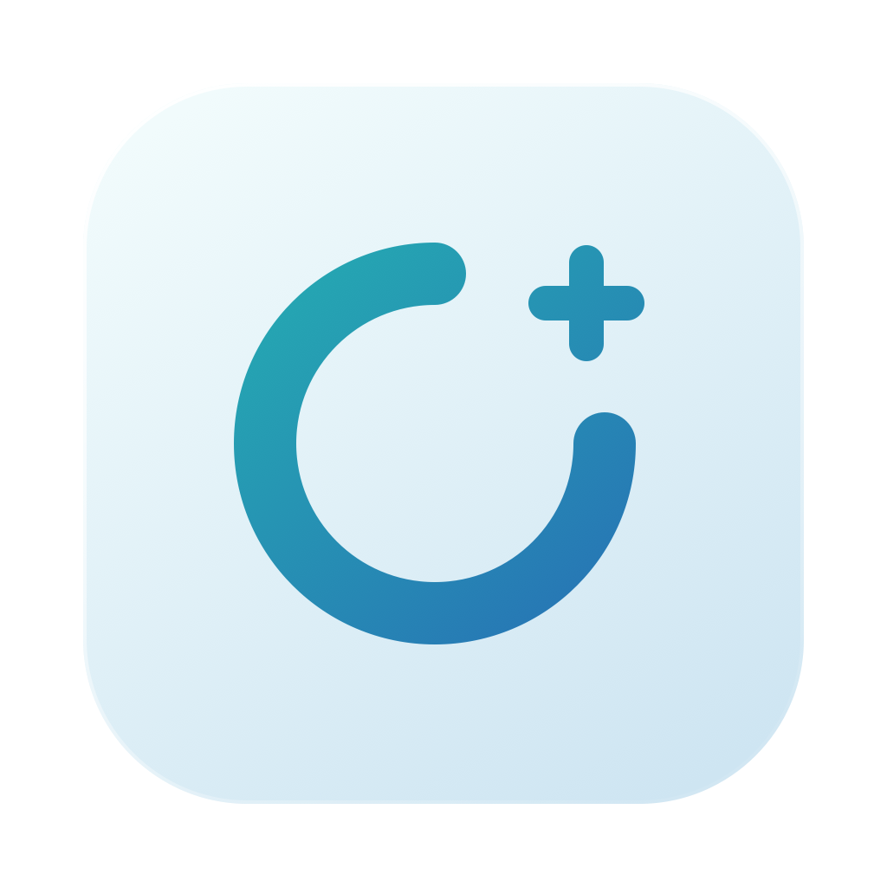

# OCLP Doctor

**Read-only diagnostics for older Intel Macs running OpenCore Legacy Patcher.**

OCLP Doctor brings hardware, boot, patch, and sleep/wake evidence into one native macOS app. It helps you review what macOS reports and where information is missing.

**Beta 0.5.1.** This is an independent, unofficial project. It is not affiliated with Dortania, the OpenCore Legacy Patcher developers, or Acidanthera. It does not install OCLP or repair your Mac.

[Releases](https://github.com/bostonnoah11-create/OCLP-doctor/releases) · [Report a bug](https://github.com/bostonnoah11-create/OCLP-doctor/issues/new/choose) · [Contribute](CONTRIBUTING.md)

## What it shows

- **Findings first:** recorded problems, compatibility references, and evidence gaps appear before general observations.
- **Hardware and memory:** reported model identity, CPU, individual GPUs, Metal information, RAM slots, and available ECC counters.
- **Boot and patches:** OpenCore boot evidence, installed OCLP software, patch metadata, and current security settings, kept distinct.
- **Sleep & Wake:** bounded seven-day history, a focused latest-wake interval, error categories, Bluetooth lifecycle evidence, and explicit source-coverage limits.
- **Known Issues:** a dated, offline selection of official OpenCore and OCLP references. Refresh collects local evidence; it does not update this catalog online.
- **Reports:** selectable evidence, an explicit Copy Report action, and a CLI with text or JSON output.

The English interface supports light/dark appearance, resizable windows, and accessibility contrast/transparency settings. macOS 26 uses Liquid Glass for compact controls; earlier supported systems use native material fallbacks. The original SVG icon is included in [Assets](Assets/).

## Understanding results

`Healthy` confirms an individual observation, not overall system health. `Unknown` means evidence is missing or insufficient. A reported Metal capability, OK memory status, or installed patch does not prove that the corresponding hardware or driver works correctly.

Log counts are records, not unique incidents. Fault is a log level, not a confirmed failure. Nearby events do not establish a cause, and no matching errors does not prove a successful wake. Focused and history counts overlap; do not add them together. Coverage and sampling limits remain visible alongside results.

## Privacy and scope

Collection runs locally without administrator authentication. The app makes no automatic network requests, uploads nothing, and does not automatically save reports. Source links open only when selected; Copy Report changes the clipboard only when requested. The CLI writes results to standard output.

The app reads selected system information and existing logs. It does not change EFI, NVRAM, SIP, patches, or power settings. There are no recovery actions or background monitoring.

Selected fields and bounded excerpts are retained, with best-effort redaction. Redaction is not a guarantee that a report is safe to publish. Review results locally and share only a short, sanitized summary. Do not attach raw logs, full reports, private files, or identifying information to public issues. See [CONTRIBUTING.md](CONTRIBUTING.md).

## Requirements

| Purpose | Requirement |
| --- | --- |
| App deployment target | Intel `x86_64`, macOS 12 or later |
| Build | macOS 26 SDK and its matching Swift toolchain, from Xcode or Command Line Tools; verified with Swift 6.3.3 / SDK 26.5 |
| Automated tests | Swift 6 or later with Swift Testing; the verified test runtime requires macOS 14 or later |
| Window | At least a 1040 × 720 content area |
| Dependencies | No external Swift package dependencies |

The deployment target is not a claim of testing on every supported OS. Real MacBookPro11,3 testing, macOS 12–15 runtime checks, and some manual interaction/accessibility checks remain outstanding. Big Sur and native Apple Silicon are outside the current app target. See the [validation record](Documentation/VALIDATION.md) for tested coverage and remaining work.

## Download

Packaged betas are listed under [GitHub Releases](https://github.com/bostonnoah11-create/OCLP-doctor/releases). Choose the Intel ZIP, extract it, and open `OCLP Doctor.app`. These early packages are ad-hoc signed and not notarized; macOS may block a downloaded app. Building locally is also supported below. This project does not ask you to disable Gatekeeper or other system protections.

## Build and run

From the repository directory:

```sh
bash Scripts/test.sh
bash Scripts/build-app.sh
open 'dist/OCLP Doctor.app'
```

The script builds the Intel app, renders its SVG icon, and writes `dist/OCLP Doctor.app`. Run it in a normal macOS development environment; restricted shells can prevent native icon packaging. Build caches stay in `.build/`. With Xcode installed, open `Package.swift` to edit the project.

You can run the built app in place or copy it to Applications. This packaging script produces an **ad-hoc signature for local testing**. It does not provide Developer ID signing or notarization; this repository does not claim a notarized download.

The CLI uses the same diagnostic engine:

```sh
swift run oclp-doctor
swift run oclp-doctor --json
```

To explore synthetic data without collecting from your Mac:

```sh
swift run OCLPDoctor --demo-mac-pro
swift run OCLPDoctor --demo-macbook-pro
swift run OCLPDoctor --demo-unavailable
```

Demos are labelled as synthetic and do not validate real hardware. A real collection with dense sleep/wake logs can take one to two minutes.

After building, `bash Scripts/verify-window-layout.sh` checks page navigation at several window sizes in a logged-in macOS session. It uses synthetic data, changes only its own demo window, and exits when finished. It requires enough screen space for the minimum content area and a second window size.

## Documentation

- [Validation and remaining checks](Documentation/VALIDATION.md)
- [Collection sources and interpretation](Documentation/SOURCES.md)
- [Sleep/wake evidence and limits](Documentation/SLEEP-WAKE-SOURCES.md)
- [Official issue catalog and scope](Documentation/OFFICIAL-ISSUES.md)

## Contributing and support

Bug reports, documentation improvements, synthetic test fixtures, and carefully scoped hardware validation are welcome. Use this repository's issue forms for bugs and feature proposals, and read [CONTRIBUTING.md](CONTRIBUTING.md) before sharing evidence or opening a pull request.

This is a community beta with limited validation coverage. Helpful contributions describe a reproducible observation and its evidence without assuming a hardware diagnosis or promising a repair.

Financial sponsorship is being prepared and is not yet active. See [Supporting OCLP Doctor](Documentation/SPONSORSHIP.md) for the current status and setup plan. Using and contributing to the project remains free.

## License

OCLP Doctor is available under the [MIT License](LICENSE).
